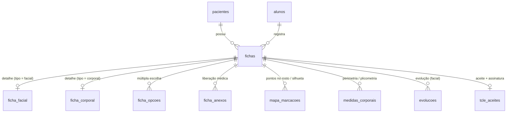

# Banco de dados — Fichas de Anamnese

SGBD: **SQLite 3** (arquivo `database/clinica.db`, ignorado pelo Git).
O script completo de criação está em [`schema.sql`](./schema.sql) e é idempotente.

```bash
pnpm db:init                                   # cria/atualiza o banco
sqlite3 database/clinica.db < database/schema.sql  # alternativa manual
```

## Relacionamentos



| Tabela | Cardinalidade | Conteúdo |
| --- | --- | --- |
| `pacientes` | — | Cadastro da modelo (Seção 01). `cpf` é único. |
| `alunos` | — | Aluno que preencheu a ficha. `email` é único. |
| `fichas` | N por paciente | Cabeçalho comum: tipo, versão, status, queixa principal e HDA. `UNIQUE (paciente_id, tipo, versao)`. |
| `ficha_facial` | 1:1 | Respostas escalares da anamnese facial (Seções 02–04). |
| `ficha_corporal` | 1:1 | Respostas escalares da anamnese corporal (Seções 03–07), IMC e RCQ. |
| `ficha_opcoes` | 1:N | Checkboxes: `grupo` (ex.: `textura`) + `opcao` (ex.: `lisa`). |
| `ficha_anexos` | 1:N | Arquivos de liberação médica / laudo (BLOB). |
| `mapa_marcacoes` | 1:N | Pontos marcados na imagem (posição em %, vista, alteração, grau, descrição). |
| `medidas_corporais` | 1:N | Medidas por região: início, durante e alta. |
| `evolucoes` | 1:N | Registro cronológico de sessões (ficha facial). |
| `tcle_aceites` | 1:1 | Aceite do TCLE e assinatura do paciente (PNG em BLOB). |

A visão `vw_fichas_resumo` junta ficha, paciente, aluno e situação do TCLE para consultas.

## Regras de negócio

- **Salvar ficha** grava um **rascunho** da versão atual; salvar novamente atualiza o mesmo registro.
- **Salvar como vN** conclui a versão. Exige queixa principal, aceite do TCLE e assinatura do paciente
  (validado no navegador e na API).
- Uma versão **concluída não pode ser alterada**: novas alterações geram a versão seguinte (v2, v3, …).
- Respostas Sim/Não: `1` = Sim, `0` = Não, `NULL` = não respondida.
- Os códigos aceitos em cada coluna de opção única estão nos `CHECK` do schema e em `shared/constants/*.ts`.

## Consistência entre formulário e banco

As colunas de `ficha_facial` e `ficha_corporal` correspondem às chaves declaradas em
`shared/constants/facial.ts` e `shared/constants/corporal.ts`. Ao iniciar, a API confere se todas
existem no banco e interrompe com a lista de colunas faltantes caso o schema esteja desatualizado.
Para adicionar um campo: declare-o nas constantes, adicione a coluna no `schema.sql`
(e um `ALTER TABLE ... ADD COLUMN` em bancos já existentes) e reinicie a API.
