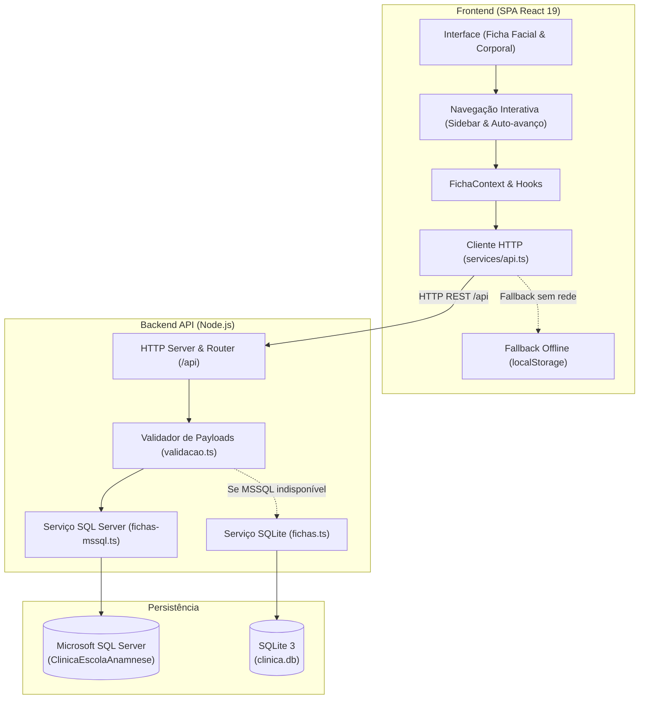

# Documentação de Arquitetura — Clínica-Escola Senac

## 1. Visão Geral

A aplicação **Fichas de Anamnese — Clínica-Escola Senac** foi arquitetada como uma SPA (Single Page Application) em React integrada a um backend Node.js modular e persistência primária em **Microsoft SQL Server**, com suporte a contingência/fallback em **SQLite**.

A solução atende aos fluxos de anamnese facial e corporal, contemplando:
- Cadastro e identificação completa do paciente e do aluno responsável.
- Mapeamento anatômico de marcações em SVG/Canvas (rosto e silhueta corporal).
- Histórico de versões imutáveis após conclusão (v1, v2, ...).
- Cálculo em tempo real de biométricas (IMC e RCQ).
- Captura de assinatura digital e termo de consentimento (TCLE).
- **Navegação Interativa e Transição Automática:** Menu lateral com links diretos entre as fichas e avanço automático para a próxima página após salvar sem pendências.

---

## 2. Padrões de Projeto e Separação de Responsabilidades

1. **Camada Compartilhada (`shared/`):**
   - Centraliza os contratos de dados e regras de negócio invariantes (`shared/types.ts`, `shared/forms.ts`).
   - Define os identificadores das colunas, tipos e constantes (`shared/constants/`).

2. **Frontend (`src/`):**
   - **Componentes:** Estruturados em blocos de campos atômicos (`SimNao`, `GrupoOpcoes`, `Entradas`) e seções completas.
   - **Barra Lateral (`Sidebar.tsx`):** Navegação dinâmica entre `#/facial` e `#/corporal` com destaque visual da rota ativa.
   - **Fluxo do Formulário (`PaginaFicha.tsx`):** Ao acionar o salvamento, valida se existem pendências obrigatórias; se tudo estiver completo, persiste no banco e transiciona automaticamente para a próxima ficha.
   - **Estilização:** CSS nativo modular com tokens extraídos fielmente do design original do Figma (`src/styles/tokens.css`).
   - **Gerenciamento de Estado:** Context API encapsulada no hook `useFicha`, com persistência em tempo real e cálculo derivado.

3. **Backend (`server/src/`):**
   - **Conexão Centralizada:** Pool de conexões otimizado (`mssql.ConnectionPool`) gerenciado em `server/src/db-mssql.ts`.
   - **Transacionalidade:** Todas as operações que envolvem cabeçalho e detalhes utilizam transações estritas (`sql.Transaction`) garantindo atomicidade (ACID).
   - **Segurança:** Utilização estrita de consultas parametrizadas (`req.input()`), prevenindo injeção de SQL.
