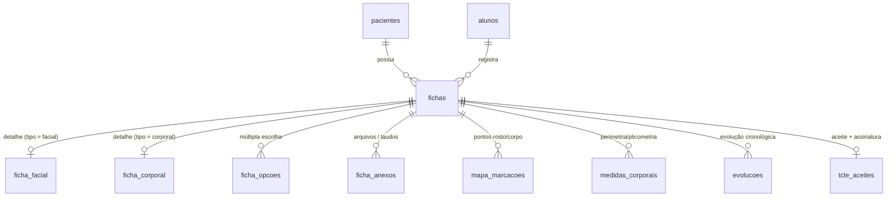

# Modelagem de Dados — Microsoft SQL Server

**Banco de Dados:** `ClinicaEscolaAnamnese`

---

## 1. Diagrama Entidade-Relacionamento

---

## 2. Dicionário de Tabelas

### `dbo.alunos`

| Coluna        | Tipo              | Restrições                          | Descrição            |
| :------------ | :---------------- | :------------------------------------ | :--------------------- |
| `id`        | `INT`           | `IDENTITY(1,1) PRIMARY KEY`         | Identificador único   |
| `nome`      | `NVARCHAR(255)` | `NOT NULL`                          | Nome completo do aluno |
| `email`     | `NVARCHAR(255)` | `NOT NULL UNIQUE`                   | E-mail institucional   |
| `criado_em` | `DATETIME2`     | `NOT NULL DEFAULT SYSUTCDATETIME()` | Data de criação      |

### `dbo.pacientes`

| Coluna            | Tipo              | Restrições                          | Descrição                   |
| :---------------- | :---------------- | :------------------------------------ | :---------------------------- |
| `id`            | `INT`           | `IDENTITY(1,1) PRIMARY KEY`         | Identificador único          |
| `cpf`           | `NVARCHAR(20)`  | `NOT NULL UNIQUE`                   | CPF do paciente               |
| `nome`          | `NVARCHAR(255)` | `NOT NULL`                          | Nome do paciente              |
| `telefones`     | `NVARCHAR(100)` | `NULL`                              | Telefones de contato          |
| `atualizado_em` | `DATETIME2`     | `NOT NULL DEFAULT SYSUTCDATETIME()` | Data da última atualização |

### `dbo.fichas`

| Coluna               | Tipo              | Restrições                        | Descrição                   |
| :------------------- | :---------------- | :---------------------------------- | :---------------------------- |
| `id`               | `INT`           | `IDENTITY(1,1) PRIMARY KEY`       | Identificador único          |
| `paciente_id`      | `INT`           | `FK pacientes(id)`                | Referência ao paciente       |
| `aluno_id`         | `INT`           | `FK alunos(id)`                   | Referência ao aluno          |
| `tipo`             | `NVARCHAR(20)`  | `CHECK ('facial', 'corporal')`    | Tipo da anamnese              |
| `versao`           | `INT`           | `CHECK (versao >= 1)`             | Versão cronológica da ficha |
| `status`           | `NVARCHAR(20)`  | `CHECK ('rascunho', 'concluida')` | Status da versão             |
| `queixa_principal` | `NVARCHAR(MAX)` | `NULL`                            | Queixa principal relatada     |
| `hda`              | `NVARCHAR(MAX)` | `NULL`                            | Histórico da Doença Atual   |

### `dbo.ficha_facial` e `dbo.ficha_corporal`

Tabelas com relação 1:1 com `dbo.fichas`, armazenando respostas booleanas (`TINYINT 0 ou 1`), opções únicas e métricas fisiológicas (como `peso_kg`, `estatura_m`, `imc` e `rcq`).

### Tabelas Filhas de Coleção (1:N)

- `dbo.ficha_opcoes`: Armazena grupos de múltipla escolha (ex: características da pele, hábitos).
- `dbo.ficha_anexos`: Armazena laudos e documentos em `VARBINARY(MAX)`.
- `dbo.mapa_marcacoes`: Posições percentuais (`pos_x`, `pos_y`) e alterações demarcadas na silhueta/rosto.
- `dbo.medidas_corporais`: Valores de perimetria e plicometria (início, durante, alta).
- `dbo.evolucoes`: Histórico de procedimentos sessão a sessão.
- `dbo.tcle_aceites`: Registro de consentimento e imagem da assinatura digital (`VARBINARY(MAX)`).
